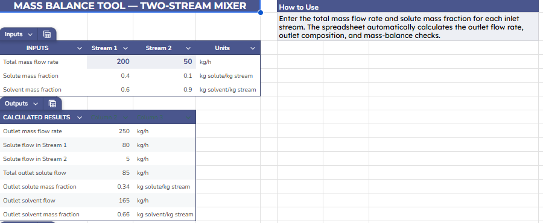

# Mass Balance Mixer Calculator

**Applied Engineering Lab — Learn. Calculate. Design. Build.**

## Project Overview

The Mass Balance Mixer Calculator is a spreadsheet-based chemical engineering tool designed to calculate the outlet flow rate and composition when two liquid streams are mixed.

It applies the principle of conservation of mass to determine the total outlet flow, component flow rates, and outlet mass fractions. Built-in checks help verify that the calculated results satisfy the overall and component mass balances.

The calculator is intended for learning, engineering calculations, and demonstrating fundamental process engineering concepts.

## Project Objectives

- Calculate the total outlet mass flow rate from two inlet streams.
- Determine the flow rate of each component in the outlet.
- Calculate the outlet composition using component mass fractions.
- Verify overall, solute, and solvent mass balances.
- Demonstrate how spreadsheet formulas can be used for engineering calculations.

## Process Description

Two inlet streams enter a mixer and form one outlet stream.

The example considers a solute and a solvent. No chemical reaction or mass loss is assumed during mixing.

## Worked Example

| Parameter | Stream 1 | Stream 2 |
|---|---:|---:|
| Total mass flow rate | 100 kg/h | 50 kg/h |
| Solute mass fraction | 0.40 | 0.10 |
| Solvent mass fraction | 0.60 | 0.90 |

### Calculated outlet

- **Total outlet flow rate:** 150 kg/h
- **Total solute flow rate:** 45 kg/h
- **Outlet solute mass fraction:** 0.30 (30%)
- **Total solvent flow rate:** 105 kg/h
- **Outlet solvent mass fraction:** 0.70 (70%)

## Governing Equations

### 1. Overall mass balance

For steady-state mixing with no accumulation or mass loss:

Total inlet mass flow rate = Total outlet mass flow rate

\[
\dot m_{out}=\dot m_1+\dot m_2
\]

### 2. Component mass balance

For the solute:

\[
\dot m_{solute,out}=\dot m_1x_1+\dot m_2x_2
\]

where \(x_1\) and \(x_2\) are the solute mass fractions of the inlet streams.

### 3. Outlet composition

\[
x_{solute,out}=\frac{\dot m_{solute,out}}{\dot m_{out}}
\]

The solvent mass fraction is:

\[
x_{solvent,out}=1-x_{solute,out}
\]

The component mass fractions should sum to 1.

## Tools Used

- Google Sheets
- Microsoft Excel-compatible spreadsheet
- Spreadsheet formulas and validation checks
- Chemical engineering mass balance principles

## How to Use the Calculator

1. Enter the mass flow rate of each inlet stream.
2. Enter the solute mass fraction for each stream.
3. Check that each fraction is between 0 and 1.
4. Review the calculated outlet flow rate and component composition.
5. Check the mass-balance residuals and confirm that they are zero, allowing for rounding.

The solvent mass fraction is calculated as one minus the solute mass fraction.

## Assumptions

- Steady-state operation.
- Complete mixing.
- No chemical reaction.
- No accumulation inside the mixer.
- No leakage or mass loss.
- Each stream contains the specified solute and solvent.
- Component mass fractions are between 0 and 1 and sum to 1.
- All mass flow rates use kg/h.

## Limitations

This calculator represents a simplified two-component mixing problem. It does not model chemical reactions, phase changes, heat transfer, or non-ideal mixing. Results depend on the validity of the input data and stated assumptions.

This educational tool should not be used as the sole basis for safety-critical or operational plant decisions.

## Project Files

- **Excel calculator:** `mass-balance-mixer-calculator.xlsx`
- **Online spreadsheet:** [Insert your Google Sheets sharing link here]

## Future Improvements

- Add support for additional inlet streams.
- Extend the calculator to more than two components.
- Add input validation and automated error messages.
- Develop additional material balance examples.
- Extend the project to energy balance calculations.

## Project Status

**Initial version:** Two-stream, two-component mixer mass balance calculator with outlet composition calculations and conservation-of-mass checks.

## About Applied Engineering Lab

Applied Engineering Lab develops educational engineering calculators, worked examples, and practical technical resources.

**Learn. Calculate. Design. Build.**

## Calculator Preview

